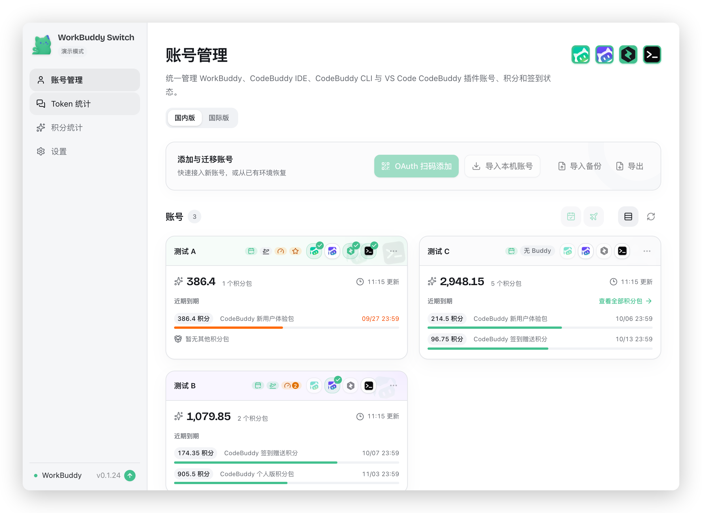
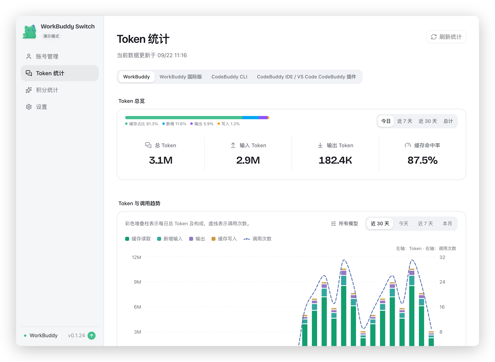
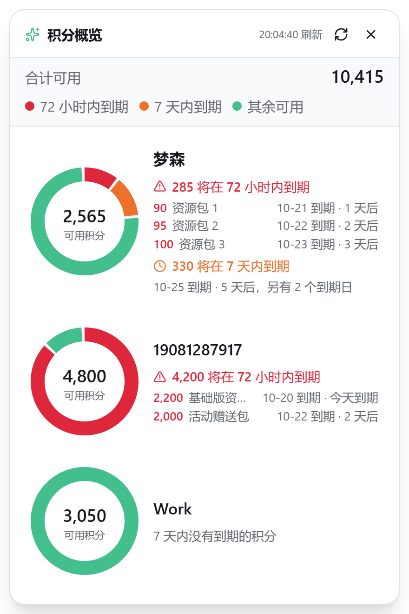
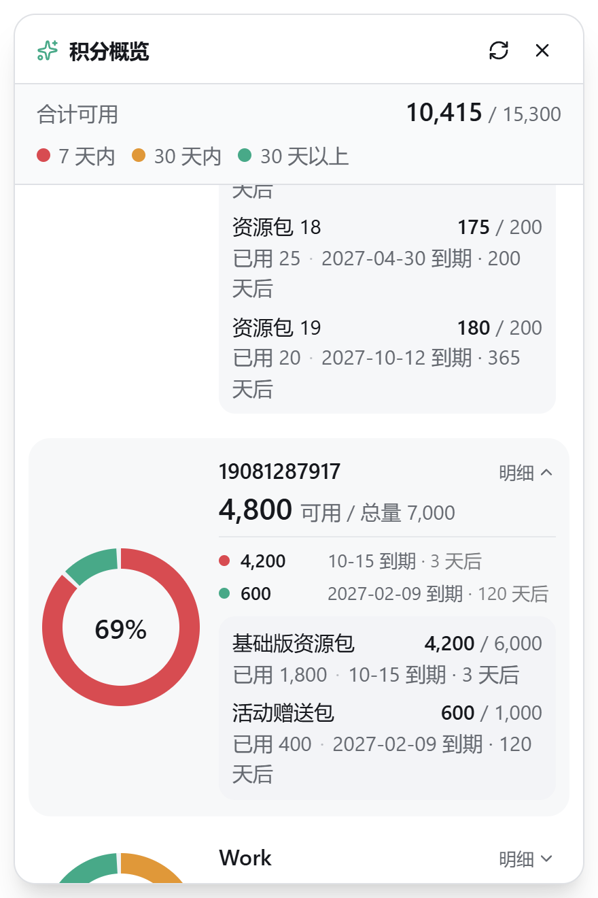
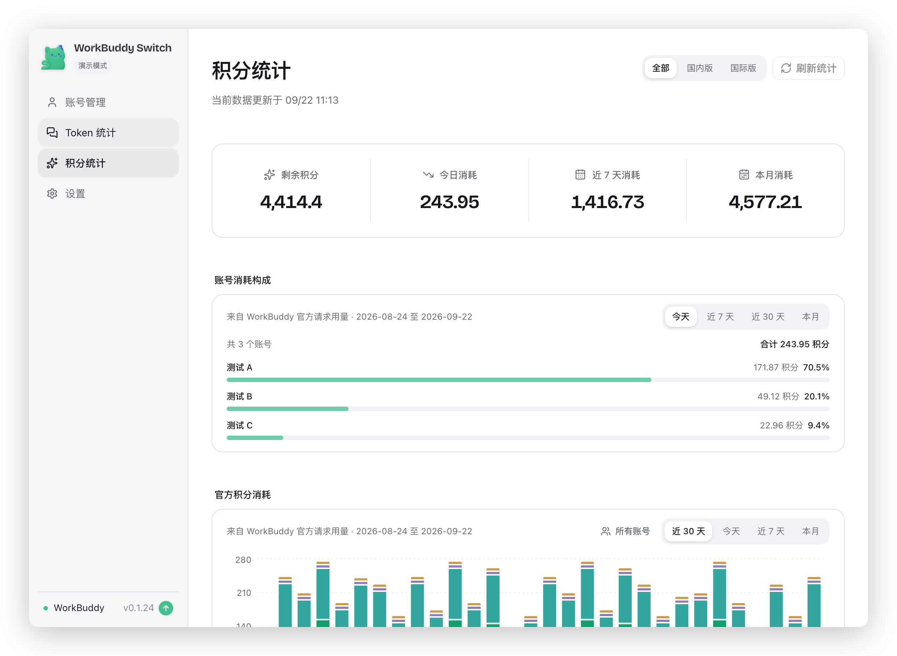
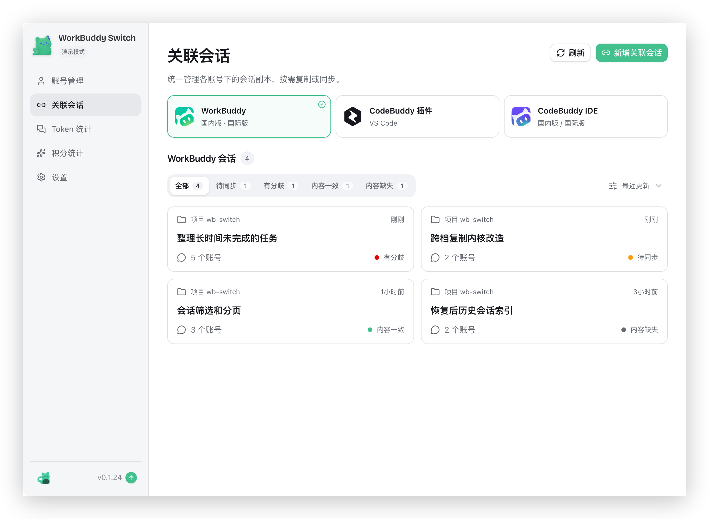

# workbuddy-switch（定制版）

> 一个面向 Windows 的 WorkBuddy 多账号管理桌面应用：多账号切换、额度轮换、Token 与积分统计，外加一个常驻右下角的**积分概览悬浮窗**。
>
> 本项目是基于开源项目 [`changexbc/workbuddy-switch`](https://github.com/changexbc/workbuddy-switch) 的**个人定制分支**，在上游 v0.1.60 基础上做了一系列功能裁剪与界面重做。

<p align="center">
  
</p>

---

## 目录

- [定制版做了什么](#定制版做了什么)
- [功能特性](#功能特性)
- [积分概览悬浮窗](#积分概览悬浮窗)
- [更新记录](#更新记录)
- [技术栈](#技术栈)
- [本地开发](#本地开发)
- [构建与打包](#构建与打包)
- [界面预览](#界面预览)
- [目录结构](#目录结构)
- [常见问题](#常见问题)
- [致谢](#致谢)
- [许可](#许可)

---

## 定制版做了什么

相对上游原版，这一分支主要做了四件事，外加后续的持续打磨：

| 改动 | 说明 |
| --- | --- |
| 🗑️ **删除「会话悬浮窗」** | 移除原版 Agent Companion 会话悬浮窗及其 sidecar 运行时（`agent-studio-runtime`）、相关命令、托盘菜单、权限配置。安装包体积从 **9.26 MB → 6.73 MB** |
| ✨ **新增「积分概览悬浮窗」** | 独立无边框窗口，环形图展示每个账号的**可用积分**与**到期紧急度**，常驻屏幕右下角，支持整卡拖动、8 向自由缩放 |
| 🔧 **支持工具联动过滤** | 在设置里关闭某个工具后，Token 统计 / 关联会话中不再显示该工具的数据 |
| 🔢 **Token 数字完整显示** | Token 数量一律使用完整千分位（如 `1,234,567`），不做 `1.2M` 之类的缩写 |

后续版本又陆续加入了：托盘指针行为（悬停预览 / 单击 / 双击）、刷新时间显示、双击环形图跳转积分统计页、3 天内到期积分逐笔提示等。详见[更新记录](#更新记录)。

---

## 功能特性

- **多账号管理** — 同时管理多个 WorkBuddy 账号，一键切换当前活跃账号
- **额度轮换** — 按策略自动在账号间轮换，避免单账号额度耗尽
- **账号总览** — 一眼看清每个账号的套餐、额度余量与用量进度
- **Token 统计** — 按账号 / 工具 / 时间维度统计 Token 消耗，完整千分位展示
- **关联会话** — 查看会话与账号的关联关系，支持分支视图
- **积分统计** — 完整展示每个积分资源包的总额、剩余、已用与到期时间
- **积分概览悬浮窗** — 常驻右下角的迷你窗口，环形图直观展示可用积分与到期风险
- **支持工具开关** — 可关闭不需要的工具，统计与关联会话同步过滤

<p align="center">
  
</p>

---

## 积分概览悬浮窗

这是定制版的核心新增功能。悬浮窗独立于主窗口，无边框、透明背景、始终置顶，默认停靠在主屏右下角。

<p align="center">
  
</p>

### 环形图怎么读

**整个圆环代表该账号的「可用积分」**，按紧急度切成三段：

| 颜色 | 含义 |
| --- | --- |
| 🟥 红段 | **72 小时内**到期的积分（最紧急） |
| 🟧 橙段 | **72 小时 ～ 7 天（168 小时）内**到期的积分 |
| 🟩 绿段 | 其余（7 天以上到期） |

圆环中心显示可用积分的具体数字。**只分这三档、不按积分包逐笔分段** —— 后者会让十几个到期日挤成满环的碎色块，反而看不清。

> **「可用积分」的口径**：只统计**尚未过期**的资源包剩余量。已过期的积分不计入环中。

### 文字提示

每个账号卡片在圆环下方给出提示，按紧急度分色，两档可以同时出现（上面红、下面橙）：

1. **72 小时内到期** → 🔴 红色合计 + **逐笔列表**，每笔都标出到期日与剩余天数，例如：
   ```
   2,200 · 基础版资源包 · 10-23 到期 · 3 天后
     90 · 资源包 1      · 10-21 到期 · 1 天后
   ```
   只有一笔时则直接标一行「最近的到期时间」。
2. **72 小时 ～ 7 天内到期** → 🟠 橙色合计 + 最近到期日（如「10-25 到期 · 5 天后，另有 2 个到期日」）。
3. **7 天内没有到期** → 灰色文字「7 天内没有到期的积分」。

### 交互

<p align="center">
  
</p>

| 操作 | 效果 |
| --- | --- |
| 按住卡片任意位置拖动 | 移动窗口到任意位置 |
| 拖拽窗口边缘 / 四角 | 自由缩放（最小 320 × 240） |
| **双击环形图** | 跳转到主窗口的「积分统计」页 |
| 点击右上角刷新按钮 | 手动刷新积分，旁边会贴上刷新时间 |
| 托盘图标 **悬停** | 弹出预览态悬浮窗，指针移开自动收起 |
| 托盘图标 **单击** | 显式打开悬浮窗（移开指针不会收起） |
| 托盘图标 **双击** | 打开主界面 |
| 主窗口底栏「✦ 积分概览」 | 打开 / 关闭悬浮窗 |
| 托盘右键菜单「显示积分概览」 | 打开 / 关闭悬浮窗（带勾选状态） |

### 入口一览

- 主窗口底部工具栏的 **✦ 积分概览** 按钮
- 托盘右键菜单的 **显示积分概览**（CheckMenuItem，状态与窗口可见性同步）
- 托盘图标的**指针行为**（Windows 有效）

---

## 更新记录

> 定制版从上游 **v0.1.60** 起步。以下按版本倒序列出每个版本的改动。

### v0.1.70 — 环形图改为三档：72 小时红 / 7 天橙

**新增**
- **环形图按紧急度切成三段**：
  - 🟥 红 `--credit-expiring` = **72 小时内**到期
  - 🟧 橙 `--credit-soon` = **72 小时 ～ 7 天（168 小时）**内到期
  - 🟩 绿 `--credit-safe` = 其余
- **72 小时内到期用红色显示，并标出最近的到期时间**：合计一行红字，下面逐笔列出金额 / 包名 / 到期日 / 剩余天数；只有一笔时直接标「MM-DD 到期 · N 天后」。
- **72 小时 ～ 7 天内到期用橙色显示**：合计一行橙字 + 最近到期日与同日计数。
- 两档可同时出现（上红下橙），图例同步为三色并带鼠标悬停说明。

**调整**
- 红色从偏珊瑚的 `oklch(0.622 0.208 25)`（≈ `#EA3E40`）调深为 `oklch(0.585 0.215 22)`（≈ `#DF273C`），与橙 `#ED712B` 拉开色相 / 明度差 —— 否则在 15px 的细环上红橙几乎分不出来。顺带把红字在白底上的对比度提高了一档。
- 橙色刻意避开之前被否掉的浊琥珀（`oklch(0.735 0.137 70)` ≈ `#E09839`），改用高彩度的 hue 46 真橙。
- 后端缺 `resources` 明细时，`expiringSoonRemaining` 归入橙段（原先一律算绿），口径更贴合官方字段含义。

**说明**
- 截止窗口仍以**整天**判定：「距今天数 ≤ 3」即 72 小时内、「≤ 7」即 168 小时内 —— 因为官方 `expireAt` 是到期日当天 00:00，在真实数据上二者等价，也避免同一屏出现两种天数口径。

### v0.1.69 — 3 天内到期逐笔列出 + 修复「今天到期」被误判失效

**新增**
- 灰色提示文字改为**逐笔列出 3 天内到期的积分及数额**（原先只显示合计与最近到期日）。每一笔积分单独列出，包名保留，便于判断消费顺序。
- 明细行改为 flex 三段布局（金额 / 包名 / 到期日）：包名可截断让位，**金额与到期日永远完整显示**，修复窄窗口下「今天到期」被截成「今天…」的问题。

**修复**
- 🐛 **「今天到期」的积分被误判为已失效**。官方接口给出的 `expireAt` 是**到期日当天 00:00**，原实现用 `expireAt <= now` 判过期，导致**只要过了当天零点，当天到期的积分类包就被整笔剔除** —— 既不计入可用积分，也不出现在到期提示里。
  - 修复方式：改为**整天口径**，新增 `startOfDay()` / `daysUntil()`（今天到期记作 0 天），`isExpired = startOfDay(expireAt) + 1 天 <= startOfDay(now)`。到期日当天仍然可用，过了次日零点才失效。
  - 同时统一 `toneOf` / `formatLeft` / 紧急窗口判定到 `daysUntil`，避免同一屏出现两种天数口径。
  - 修复效果：某账号环心从 `2,600` 恢复为 `4,800`，明细中出现「2,200 · 基础版资源包 · 10-13 到期 · 今天到期」。

### v0.1.68 — 悬停预览：指针移开自动收起

- 托盘悬停弹出的**预览态**悬浮窗，在指针离开后自动收起。
- **收起判定采用轮询 + 重置计时**（110 ms 轮询，指针连续 350 ms 不在窗口范围内才收起），而不是一次性定时器 —— 指针从托盘图标移向悬浮窗的路上既不在图标上也不在窗上，一次性判定会在半路就把窗口收掉。
- 位置判定在 Rust 侧读取光标位置与窗口矩形（同为虚拟屏幕物理像素，可直接比较），不用前端 `mouseleave` —— 预览窗口不抢焦点、从不是激活窗口，webview 无法保证收到鼠标进出事件。
- 收起只 `hide()` 不销毁窗口（WebView2 重新建窗要几百毫秒，影响下次「立刻显示」的体验）。

### v0.1.67 — 托盘指针行为、刷新时间、双击环跳转

**新增**
- **托盘指针行为（Windows）**：
  - **悬停** → 弹出预览态悬浮窗；**单击** → 显式打开悬浮窗；**双击** → 打开主界面。
  - 只有**预览态**会自动收起，显式打开（底部按钮 / 托盘菜单 / 单击）后移开指针不会收起。
  - 悬停弹出**不抢焦点**，不会把你正在使用的程序切走。
  - macOS 不启用该行为（左键保留给托盘菜单）。
- **刷新时间显示**：悬浮窗右上角在刷新后贴上 `HH:MM:SS 刷新` 时间戳，刷新过程中显示「刷新中…」。
- **双击环形图跳转**：双击任意账号的环形图，自动打开主窗口并跳转到「积分统计」页。

**修复**
- 🐛 **Windows 一次双击会派发 4 个事件**（按下 → 抬起 → 双击 → 抬起），原实现会导致「先闪一下悬浮窗、主界面之上再冒一次悬浮窗」。新增 `TrayClickArbiter` 仲裁：单击挂起 400 ms，双击则作废挂起项并在其后 400 ms 内忽略单击。
- 🐛 修复 Windows 上 `tray.rs` 测试模块编译不过的问题（条件化平台相关导入）。

**其他**
- 环形图等需要响应**双击**的元素加上 `data-no-drag` 豁免 —— 窗口拖动在按下瞬间即进入系统级模态循环，鼠标抬起回不到 webview，双击事件永远凑不齐。

### v0.1.66 — 自由缩放 + 砍掉明细 + 更换配色

**新增**
- **悬浮窗自由缩放**：无边框窗口没有系统 resize 边框，改为在窗口最外层铺设 **8 条透明手柄**（四边 + 四角），拖拽任意边角即可调整大小，最小 320 × 240。

**调整**
- **砍掉悬浮窗内的积分明细**：原先堆积在卡片里的逐笔明细过于拥挤，予以删除。悬浮窗只做「概览」，**完整积分包明细回归主窗口的「积分统计」页**。
- 保留「还有多少积分、会在几天内到期」的文字提示（仅显示未来 7 天内会到期的积分）。

**修复**
- 🐛 删除被用户明确否掉的琥珀色档位（`--credit-warn`，色值恰为 `#E09839`），环形图配色收敛为红 / 绿两段。

### v0.1.65 — 环形图重做 + 整体放大

- **环形图按紧急度聚合**：不再按每一笔积分包分段（那会让 20+ 笔到期日挤成满环 1~2 px 的碎色块），改为按紧急度聚合。
- **窗口尺寸放大**：从 360 × 480 调整到 **440 × 660** —— 原尺寸会把圆环和 22 px 的大字压成一堆小字，辨认困难。
- 配色改为红 / 琥珀 / 绿三档（琥珀档在下一版被移除）。

### v0.1.64 — 删除会话悬浮窗

- **彻底移除「会话悬浮窗」（Agent Companion）** 及其全部相关代码，由积分概览悬浮窗取代：
  - Rust：`companion` 模块、`agent-studio-desktop` 依赖、插件注册、3 个命令、2 项托盘菜单、`capabilities/agent-studio.json`、`tauri.conf.json` 的 `externalBin`、`build.rs` 中的 sidecar 目标。
  - 前端：`CompanionFooter` / `CompanionDemoFooter`、设置页的 Companion 卡片、`api.ts` 的 companion 封装、`use-companion-enabled.ts`、演示对话框与脚本、托盘图标资源。
  - 脚本：`prepare-agent-companion.mjs`、`prepare-companion-demo.mjs`、`vendor-agent-companion.mjs`。
- **收益**：安装包体积 **9.26 MB → 6.73 MB**；构建流水线大幅简化，不再需要编译 sidecar。
- 上游 `vendor/agent-companion/` 源码保留在仓库中供参考，但不再参与编译。

### v0.1.63 — 悬浮窗独立页面入口（关键架构修复）

**修复**
- 🐛 **悬浮窗渲染成整个主界面**。根因是悬浮窗与主窗口共用 `index.html`，靠运行期窗口 label 分流，判定不成立时悬浮窗直接渲染出整套主界面（既没有环形图，也没有拖拽区）。
  - 修复方式：新增**独立页面入口** `credit-float.html` + `src/credit-float.tsx`，Vite 配置双入口（`main` + `creditFloat`），Rust 侧用 `WebviewUrl::App("credit-float.html")` 加载。
  - `main.tsx` 中的 label 分流逻辑保留作为第二道防线。
- **整卡可拖动**：在卡片容器上手动调用窗口拖动，用户按住正文任意位置都能拖（只把拖拽区挂在细标题栏上时，按住正文拖动没有反应）。
- 账号列表与窗口状态解耦。

### v0.1.61 — 悬浮窗定位修复

**修复**
- 🐛 **悬浮窗出现在屏幕外 / 位置错乱**。无边框窗口若不显式定位，会套用 Windows 的默认层叠位置，多显示器下极易跑到屏幕外。
  - 修复方式：创建窗口时先保持不可见 → 读取主屏工作区与缩放比例，换算为逻辑像素定位到右下角（边距 24 px）→ 再显示。

---

## 技术栈

| 层 | 技术 |
| --- | --- |
| 桌面框架 | [Tauri 2](https://v2.tauri.app/)（Rust） |
| 前端 | React 19 + TypeScript + Vite 7 |
| 样式 | Tailwind CSS 4 + [shadcn/ui](https://ui.shadcn.com/) 风格组件（Radix UI） |
| 状态 | zustand |
| 图表 | recharts |
| 测试 | Vitest（前端） + `cargo test`（Rust） |
| 核心逻辑 | `crates/wb-switch-core`（账号、积分、Token、会话关联等） |
| 服务层 | `crates/wb-switch-server`（HTTP / CLI） |

---

## 本地开发

### 环境要求

- **Node.js** ≥ 20
- **Rust** 稳定版工具链（含 `cargo`）
- **Windows**（托盘指针行为仅 Windows 生效；macOS 亦可编译运行）

### 安装依赖

```bash
npm install
```

### 启动开发

```bash
npm run tauri dev
```

### 运行测试

```bash
# 前端类型检查与单测
node_modules/.bin/tsc --noEmit
node_modules/.bin/vitest run

# Rust 单测
cargo test -p wb-switch-rust --lib
```

> 💡 `cargo check` 不会编译 `#[cfg(test)]` 模块，改动测试代码后请务必实际运行一次 `cargo test --lib`。

---

## 构建与打包

```bash
# 1) 构建前端
node_modules/.bin/vite build

# 2) 打包 Windows 安装包（NSIS）
node_modules/.bin/tauri build --bundles nsis --config tauri.local-override.json
```

产物位置：

```
target/release/bundle/nsis/workbuddy-switch_<version>_x64-setup.exe
```

仓库根目录的 `tauri.local-override.json` 用于本地出包，内容如下：

```json
{
  "build": { "beforeBuildCommand": "" },
  "bundle": { "createUpdaterArtifacts": false }
}
```

- `beforeBuildCommand` 置空以避免执行副作用脚本；
- 关闭 `createUpdaterArtifacts`，因为本地构建没有 updater 签名私钥。

> ⚠️ `vite build` 会清空 `dist/` 目录。若构建流程中有需要保留的静态资源，请确保在构建后重新生成。

---

## 界面预览

<table>
  <tr>
    <td align="center"><br /><sub>账号总览</sub></td>
    <td align="center"><br /><sub>积分统计</sub></td>
  </tr>
  <tr>
    <td align="center"><br /><sub>Token 统计</sub></td>
    <td align="center"><br /><sub>关联会话</sub></td>
  </tr>
</table>

---

## 目录结构

```
workbuddy-switch/
├── credit-float.html          # 积分概览悬浮窗的独立页面入口
├── index.html                 # 主窗口页面入口
├── vite.config.ts             # 前端构建配置（双入口）
├── tauri.local-override.json  # 本地出包覆盖配置
├── crates/
│   ├── wb-switch-core/        # 核心逻辑（账号 / 积分 / Token / 会话）
│   └── wb-switch-server/      # HTTP / CLI 服务层
├── src/                       # 前端（React）
│   ├── credit-float.tsx       # 悬浮窗入口
│   ├── main.tsx               # 主窗口入口
│   ├── pages/                 # 页面（含 CreditFloatPage）
│   ├── components/            # 通用组件
│   ├── lib/                   # 工具与 hooks
│   ├── stores/                # zustand 状态
│   └── assets/                # 静态资源
├── src-tauri/                 # Tauri 应用层（Rust）
│   └── src/
│       ├── credit_float.rs    # 积分概览悬浮窗
│       ├── tray.rs            # 托盘图标与指针行为
│       ├── commands.rs        # 前端可调用的命令
│       └── lib.rs             # 应用装配入口
└── docs/images/               # 文档配图
```

---

## 常见问题

<details>
<summary><b>悬浮窗不显示 / 显示为整个主界面？</b></summary>

请确认 `credit-float.html` 已被正确构建进 `dist/`。悬浮窗使用独立页面入口，若该文件缺失会回退到主界面。重新执行 `vite build` 即可。
</details>

<details>
<summary><b>悬浮窗拖不动 / 无法缩放？</b></summary>

- 拖动：按住卡片**任意位置**均可拖动。
- 缩放：拖拽窗口**边缘或四角**（无边框窗口没有系统边框，手柄是透明的）。
- 若缩放无反应，请检查 `src-tauri/capabilities/default.json` 是否放行了 `core:window:allow-start-resize-dragging`。
</details>

<details>
<summary><b>托盘悬停弹出的窗口收不起来 / 一直不消失？</b></summary>

仅**预览态**（悬停弹出）会自动收起。若通过单击托盘图标、托盘菜单或底部按钮打开，属于**显式打开**，需要手动关闭。这是刻意设计，避免你在查看时窗口被收走。
</details>

<details>
<summary><b>某个账号环心的积分比我预期的少？</b></summary>

悬浮窗只统计**尚未过期**的资源包。已过期的积分不会计入可用积分，但仍可在主窗口的「积分统计」页查看完整明细。
</details>

<details>
<summary><b>积分刷新太频繁会被风控吗？</b></summary>

项目对积分刷新做了**下限 30 分钟**的节流，避免触发官方接口的频率限制。
</details>

---

## 致谢

- 上游项目：[`changexbc/workbuddy-switch`](https://github.com/changexbc/workbuddy-switch) —— 本项目的基础
- [Tauri](https://tauri.app/)、[React](https://react.dev/)、[Vite](https://vitejs.dev/)、[Tailwind CSS](https://tailwindcss.com/)、[shadcn/ui](https://ui.shadcn.com/)、[recharts](https://recharts.org/)

---

## 许可

本项目沿用上游 [MIT License](LICENSE)。

> 本项目为个人定制分支，非上游官方发布版本。使用前请自行评估账号安全与合规风险。
